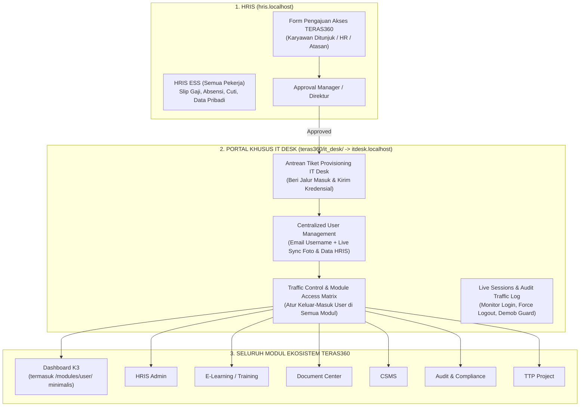

# PRD v2.0: Portal Khusus IT Desk (Centralized IAM & User Traffic Control), Redesain `/modules/user/`, & Tata Kelola Akses TERAS360–HRIS

> [!IMPORTANT]
> **Status:** Revisi v2.0 — Menunggu Review & Persetujuan User
> **Lingkup Arsitektur:**
> 1. **Portal Baru Khusus IT Desk:** `C:\laragon\www\teras360\it_desk\` (`http://itdesk.localhost/`) — Pusat Kendali Lalu Lintas Keluar-Masuk User & User Management untuk **SELURUH modul TERAS360**.
> 2. **Modul User Dashboard K3:** `dashboard-k3/modules/user/` (`k3.localhost/modules/user/`) — Redesain minimalis khusus pemantauan & manajemen user lingkup Dashboard K3, tersinkronisasi penuh dengan `terasmyi_sso` & HRIS, serta terhubung ke Portal IT Desk.
> 3. **Modul HRIS:** `teras360/hris/` (`hris.localhost/`) — Akses **HRIS ESS** untuk seluruh pekerja (Gaji, Absensi, Data Pribadi) + **Form Pengajuan Akses TERAS360** & **Approval Manager/Direktur**.
> 4. **Centralized SSO Engine:** `teras360/sso/TerasSSO.php` (`terasmyi_sso`).

---

## 1. Pemisahan Tanggung Jawab Arsitektur (Module Separation)

Agar tidak tercampur antara kebutuhan operasional per modul dan kendali akses lintas ekosistem, arsitektur dipisah tegas menjadi **3 lapis**:

| Komponen | Lokasi Folder & URL | Fungsi & Batas Kewenangan |
| :--- | :--- | :--- |
| **Portal Khusus IT Desk** *(Baru)* | `teras360/it_desk/` (`http://itdesk.localhost/`) | **Pusat kendali utama** untuk seluruh lalu lintas keluar-masuk user di semua modul (`dashboard-k3`, `hris`, `e-learning`/Training, `document_center`, `csms`, `audit`, `ttp_project`), manajemen akun terpusat, provisioning tiket yang disetujui Manager/Direktur, monitoring sesi aktif, force logout, dan *Demob/Offboarding Guard*. |
| **Modul User Dashboard K3** | `teras360/dashboard-k3/modules/user/` (`http://k3.localhost/modules/user/`) | Tampilan bersih & minimalis khusus daftar user yang mengakses **Dashboard K3** (username berbasis email, foto & profil tersinkronisasi dari HRIS, tanpa banyak warna), dilengkapi tombol pintas langsung ke **Portal IT Desk** untuk pengaturan lintas modul. |
| **Modul HRIS (ESS + Request)** | `teras360/hris/` (`http://hris.localhost/`) | Portal mandiri (**ESS**) bagi seluruh pekerja TTP (Proyek & HO) untuk memantau gaji & absensi, sekaligus pintu masuk **Pengajuan Akses TERAS360** & **Approval Manager/Direktur**. |

---

## 2. Arsitektur Akses 2-Tier (HRIS Pekerja vs TERAS360 Terbatas)

| Dimensi | Tier 1: HRIS Employee Self-Service (ESS) | Tier 2: TERAS360 Enterprise Access |
| :--- | :--- | :--- |
| **Target Pengguna** | Seluruh pekerja aktif PT. Teras Teknik Perdana (Proyek & HO) | **Hanya personel yang ditunjuk** secara resmi |
| **Cakupan Fitur** | Slip Gaji, Riwayat Absensi, Cuti/Izin, Data Pribadi | Modul operasional TERAS360 (`Dashboard K3`, `HRIS Admin`, `Training/E-Learning`, `Document Center`, `CSMS`, `Audit`, `TTP Project`) sesuai izin IT Desk |
| **Alur Aktivasi** | Aktivasi standar oleh HRIS Personalia | **Wajib:** Pengajuan di HRIS → **Approval Manager/Direktur** → **Provisioning Jalur Masuk oleh Tim IT Desk** di `itdesk.localhost` |
| **Isolasi Lalu Lintas** | Terkunci di portal HRIS ESS — **tidak bisa** masuk ke modul TERAS360 lain | Lalu lintas keluar-masuk tiap modul dibuka/ditutup per user oleh IT Desk melalui `terasmyi_sso.sso_user_module_access` |

---

## 3. Spesifikasi Portal Baru: `teras360/it_desk/` (`http://itdesk.localhost/`)

Portal khusus untuk role **`Superadmin`** dan **`IT Desk`** (terdaftar di `sso_modules` dengan `module_key = 'itdesk'`, muncul di Ecosystem Portal `ecosystem.localhost`, dan memiliki VirtualHost Apache sendiri `itdesk.localhost`).

### 3.1 Desain Visual (Clean, Functional, Minimalist)

- Mengikuti bahasa desain modern Dashboard K3 & Ecosystem: permukaan putih (`#ffffff`) & abu lembut (`#f8fafc`), border tipis (`#e2e8f0`), teks `#0f172a` / `#64748b`, **tidak banyak warna**.
- Aksen warna hanya untuk indikator status operasional kritis:
  - 🟢 Hijau lembut (`#059669`) → `Active` / `Online` / `Provisioned`
  - 🟡 Amber lembut (`#d97706`) → `Pending Approval` / `Waiting IT Desk`
  - 🔴 Merah lembut (`#dc2626`) → `Suspended` / `Demob Alert` / `Rejected`

### 3.2 Modul & Fitur Utama di `teras360/it_desk/`

1. **Overview & Traffic Control Dashboard**
   - KPI strip minimalis: Total Akun TERAS360, Sesi Aktif Saat Ini, Tiket Menunggu IT Desk, Peringatan Karyawan `Demob/Non-Active` yang akunnya masih aktif.
   - Ringkasan lalu lintas login 24 jam terakhir per modul (`Dashboard K3`, `HRIS`, `Training/E-Learning`, `Document Center`, `CSMS`, `Audit`, `Project`).

2. **Centralized User Management (Lintas Semua Modul)**
   - **Username = Email Utama** (`email` / `outlook_email` / `gmail_email`) tersinkronisasi antara `terasmyi_sso.sso_users` dan modul terkait (`dashboard-k3.users`, dll.).
   - **Live Sync Data Pribadi & Foto HRIS** (`terasmyi_hris.karyawan_baru`):
     - Foto profil (`photo_url`) otomatis tampil dari HRIS (dengan fallback inisial netral).
     - Nama lengkap, Badge ID (`id_pegawai`), Jabatan, Divisi, Proyek/HO, No. WhatsApp, Email, dan Status Aktif (`Active` / `Non Active` / `Demob`) tersinkronisasi otomatis.
     - **Privasi:** KTP 16 digit (`nik`) tidak pernah ditampilkan.
   - **Aksi IT Desk:** Tambah User, Edit Identitas & SSO Binding (Local / Google / Microsoft Outlook), Reset Password, Sync HRIS, Suspend / Offboarding Serentak (memutus akses di semua modul sekaligus).

3. **Module Traffic Matrix (Pengatur Lalu Lintas Keluar-Masuk Modul)**
   - Matriks toggle on/off akses per user untuk setiap modul TERAS360:
     `Dashboard K3` | `HRIS Admin` | `HRIS ESS` | `E-Learning / Training` | `Document Center` | `CSMS` | `Audit` | `TTP Project` | `IT Desk`
   - Mendukung **Role Preset** dan **Custom Override** per user, berlaku real-time saat user mengakses modul mana pun.

4. **Antrean Pengajuan Akses (`Access Requests Queue`)**
   - Menerima seluruh pengajuan akses TERAS360 dari HRIS.
   - Menampilkan status lengkap: `Menunggu Approval Manager/Direktur` → `Disetujui (Siap Diproses IT Desk)` → `Aktif (Provisioned)` → `Ditolak`.
   - **Form Provisioning IT Desk:** Untuk tiket berstatus `approved_waiting_it`, tim IT Desk dapat:
     - Memverifikasi Email sebagai Username & mengikat akun Google/Outlook SSO bila diminta.
     - Memilih modul yang dibuka & role yang ditetapkan.
     - Mengatur password awal (auto-generate aman + wajib ganti saat login pertama).
     - Mengisi catatan jalur masuk → klik **Provision & Aktifkan Jalur Masuk**.
     - Sistem otomatis membuat akun di `terasmyi_sso.sso_users` (+ sinkron ke `dashboard-k3.users`) dan mengirim **Email (`noreply@teras360.my.id`) & WhatsApp** ke user bersangkutan.

5. **Live Sessions & Audit Lalu Lintas (`Traffic & Audit Log`)**
   - Melihat daftar sesi login aktif (`sso_sessions`) lengkap dengan User, Provider (`Local`/`Google`/`Outlook`), IP, Perangkat, Waktu Login, dan tombol **Force Logout (Revoke)**.
   - Log audit lalu lintas keluar-masuk (`sso_audit_logs`): login sukses/gagal, perubahan izin modul, approval, provisioning, dan offboarding.
   - **Demob / Offboarding Guard:** Menandai karyawan HRIS yang berstatus `Demob` atau `Non Active` namun akun TERAS360-nya masih `active`, disertai tombol **1-Klik Cabut Semua Akses & Logout**.

---

## 4. Spesifikasi Pembaruan `dashboard-k3/modules/user/` (`k3.localhost/modules/user/`)

Agar tetap jelas perannya sebagai modul user di dalam Dashboard K3 (bukan duplikasi IT Desk):

1. **Redesain Tampilan Minimalis Selaras Dashboard K3:**
   - Hapus ikon stat multi-warna (`blue`, `purple`, `cyan`, `red`) dan badge warna-warni.
   - Ganti dengan header bersih, KPI strip monokrom/slate, tabel rapi, dan filter responsif.

2. **Username Berbasis Email & Sinkronisasi Foto/Data HRIS:**
   - Menampilkan foto dari HRIS (`karyawan_baru.photo_url`), Nama, Badge ID & Proyek/HO, **Email (Username)**, Jabatan HRIS, Role K3, Status, dan Last Login.
   - Menyembunyikan 16-digit `nik` (hanya Badge ID).

3. **Integrasi Langsung ke Portal IT Desk:**
   - Menyediakan banner/tombol **"Buka Portal IT Desk (Kelola Akses Lintas Modul & Tiket)"** menuju `http://itdesk.localhost/` (dengan SSO handoff otomatis) agar Superadmin/IT Desk bisa langsung mengatur lalu lintas modul lain (`HRIS`, `Training`, `Document Center`, dll.) dari pusat kendali IT Desk.

---

## 5. Spesifikasi Alur di Modul HRIS (`teras360/hris/`)

1. **Menu & Halaman `Pengajuan Akses TERAS360`** (`/hris/pages/ess/access_request.php`)
   - Pencarian karyawan HRIS *privacy-first* (minimal 2 karakter, lintas proyek & HO — tidak menampilkan daftar karyawan sebelum diketik).
   - Auto-fill data pribadi & foto HRIS.
   - Pilihan modul TERAS360 yang diminta (checkbox: `Dashboard K3`, `E-Learning / Training`, `Document Center`, `CSMS`, `Audit`, `TTP Project`, `HRIS Admin`), Role yang diusulkan, Metode Login (`Email+Password`, `Google SSO`, `Microsoft Outlook`), Approver (**Manager / Direktur**), dan Alasan Bisnis.
   - Pelacakan status tiket real-time (*Stepper* 4 tahap).

2. **Halaman `Approval Manager / Direktur`**
   - Manager/Direktur menerima notifikasi Email & WhatsApp berisi rincian pengajuan dan link langsung untuk **Approve** atau **Reject** (wajib alasan).
   - Setelah **Approve**, tiket otomatis masuk ke antrean **IT Desk** (`http://itdesk.localhost/`) dan mengirim notifikasi ke tim IT Desk.

3. **HRIS ESS Pekerja** (`/hris/pages/ess/index.php`)
   - Tetap difokuskan untuk layanan mandiri seluruh pekerja (Slip Gaji, Absensi, Data Pribadi, dan Status Pengajuan Akses TERAS360) tanpa membuka akses ke modul TERAS360 lainnya.

---

## 6. Rancangan Database (`terasmyi_sso`)

### 6.1 Tabel Baru `sso_access_requests`

Menyimpan seluruh siklus Pengajuan HRIS → Approval Manager/Direktur → Provisioning IT Desk.

| Kolom | Keterangan |
| :--- | :--- |
| `id_request` | Primary key |
| `request_code` | Format `REQ-YYYY-NNNN` |
| `id_karyawan` | FK ke `karyawan_baru.id_pegawai` |
| `applicant_name` | Nama pemohon |
| `applicant_email` | Email pemohon |
| `applicant_phone` | No. WhatsApp pemohon |
| `applicant_jabatan` | Jabatan pemohon |
| `applicant_project` | Proyek/HO pemohon |
| `requested_by_user_id` | ID user yang mengajukan |
| `requested_role` | Role yang diusulkan |
| `requested_modules` | JSON array modul yang diminta |
| `preferred_auth` | `local` / `google` / `outlook` |
| `justification` | Alasan bisnis |
| `approver_id_karyawan` | FK approver |
| `approver_name` | Nama approver |
| `approver_email` | Email approver |
| `approved_by_user_id` | ID user approver |
| `approved_at` | Timestamp approval |
| `approval_notes` | Catatan approval |
| `provisioned_by_user_id` | ID IT Desk yang provisioning |
| `provisioned_at` | Timestamp provisioning |
| `provisioned_user_id` | ID user yang di-provision |
| `it_desk_notes` | Catatan IT Desk |
| `status` | `pending_approval`, `approved_waiting_it`, `provisioned`, `rejected`, `cancelled` |
| `created_at` | Timestamp dibuat |
| `updated_at` | Timestamp diupdate |

### 6.2 Penambahan Modul & Role

- **Modul baru di `sso_modules`:** `itdesk` (`IT Desk & User Traffic Control`, `http://itdesk.localhost`, `https://itdesk.teras360.my.id`).
- **Role baru di `sso_role_templates`:** **`IT Desk`** (akses penuh ke `itdesk` untuk manajemen user, traffic control, dan provisioning tiket; terpisah dari role operasional HSE/HR).

---

## 7. Rencana Implementasi Bertahap

| Fase | Lingkup Pekerjaan | Target File / Infrastruktur |
| :--- | :--- | :--- |
| **Fase 1: Core SSO & VirtualHost** | Tambah tabel `sso_access_requests`, modul `itdesk`, role `IT Desk`, helper sinkronisasi HRIS (`syncUserFromHris`, `resolveHrisPhotoUrl`) di `TerasSSO.php`, plus VirtualHost Apache `itdesk.localhost` & kartu di `ecosystem.localhost`. | `teras360/sso/TerasSSO.php`, `custom.teras360.conf`, `ecosystem/index.php` |
| **Fase 2: Portal Khusus IT Desk (`teras360/it_desk/`)** | Bangun portal lengkap `itdesk.localhost`: Dashboard Traffic Overview, Centralized User Management (Email username + Live HRIS photo/profile sync), Module Access Traffic Matrix (all modules), Access Requests Provisioning Queue (+ auto-send Email & WA), Active Sessions + Force Logout + Audit Log + Demob Guard. | `teras360/it_desk/index.php`, `api/actions.php`, `includes/layout.php`, `.htaccess` |
| **Fase 3: Redesain `dashboard-k3/modules/user/`** | Perbaiki tampilan `/modules/user/` menjadi minimalis selaras Dashboard K3 (tanpa warna berlebihan), username berbasis email, foto & profil live-sync HRIS, serta tautan langsung ke Portal IT Desk (`itdesk.localhost`). | `dashboard-k3/modules/user/index.php`, `_extra_css.php`, `_extra_js.php`, `add.php`, `edit.php` |
| **Fase 4: HRIS Request & Approval Workflow** | Tambahkan form **Pengajuan Akses TERAS360** & halaman **Approval Manager/Direktur** di HRIS + integrasi notifikasi Email (`Mailer.php`) & WhatsApp (`WhatsAppNotifier.php`). | `teras360/hris/pages/ess/access_request.php`, `teras360/hris/pages/ess/index.php` |
| **Fase 5: Verifikasi End-to-End** | `php -l` semua file, `httpd -t` & restart Apache, uji akses `http://itdesk.localhost/`, uji `http://k3.localhost/modules/user/`, dan uji alur lengkap Request → Approve → IT Desk Provisioning. | Seluruh modul terdampak |

---

## 8. Checklist Verifikasi

- [ ] Tabel `sso_access_requests` dibuat dengan semua kolom
- [ ] Modul `itdesk` & role `IT Desk` terdaftar di `sso_modules` / `sso_role_templates`
- [ ] Helper `syncUserFromHris()` & `resolveHrisPhotoUrl()` berfungsi
- [ ] VirtualHost `itdesk.localhost` aktif & dapat diakses
- [ ] Portal IT Desk: Dashboard, User Management, Traffic Matrix, Provisioning Queue, Live Sessions, Audit Log, Demob Guard
- [ ] Auto-send Email & WhatsApp saat provisioning berhasil
- [ ] `dashboard-k3/modules/user/` redesain minimalis + email username + foto HRIS + tautan ke IT Desk
- [ ] Form Pengajuan Akses TERAS360 di HRIS + Stepper 4 tahap
- [ ] Halaman Approval Manager/Direktur + notifikasi Email & WA
- [ ] Alur end-to-end: Request → Approve → IT Desk Provisioning → Akun aktif
- [ ] `php -l` & `httpd -t` lolos

---

*Dokumen ini menunggu review & persetujuan user sebelum eksekusi.*
