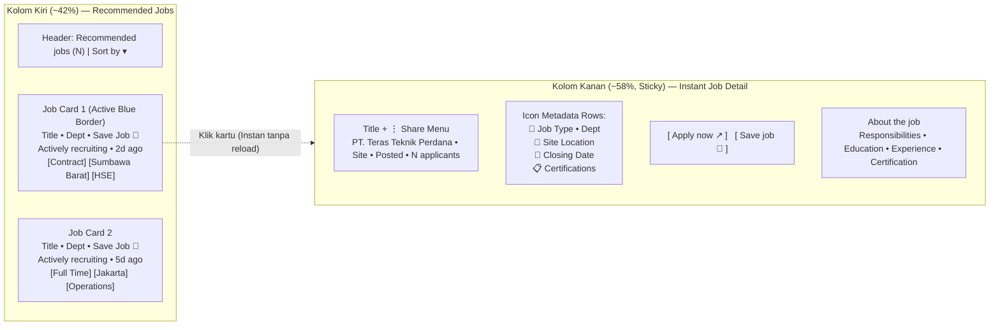

# PRD v2 — Redesign Modern Portal Karir PT. Teras Teknik Perdana (`career.localhost`)

> [!IMPORTANT]
> Dokumen ini merupakan **Product Requirements Document (PRD) lengkap** untuk memodifikasi tampilan `career.localhost` mengikuti referensi UI modern *JobSearch* yang Anda unggah, dengan tetap mempertahankan identitas resmi **PT. Teras Teknik Perdana** (`ttplogo3.png`), palet biru korporat, dan integrasi penuh ke database HRIS ATS (`lowongan`, `kandidat`, `lamaran`).
>
> Silakan tinjau spesifikasi di bawah ini dan klik **Proceed** (atau berikan catatan penyesuaian) untuk memulai implementasi.

---

## 1. Visi Produk & Tujuan

Mengubah `career.localhost` menjadi portal karir modern berstandar *enterprise job board* yang cepat, intuitif, dan elegan:
- **Zero Friction Discovery:** Kandidat dapat mencari, memfilter berdasarkan tipe kontrak/departemen/lokasi/sertifikasi, dan membaca detail lowongan secara **instan di sebelah kanan** tanpa bolak-balik halaman (pada desktop), serta tetap mendukung halaman detail penuh (`job_detail.php?id=...`) untuk mobile dan tautan berbagi (*share link*).
- **Identitas Korporat TTP yang Kuat:** Hero banner biru tua elegan dengan ilustrasi grafis halus, logo resmi `ttplogo3.png`, dan kartu putih melayang (*floating search & filter bar*) yang menyatu mulus ke area konten putih.
- **Fitur Kandidat Modern:** Fitur **Save Job (Bookmark)**, **Sort By**, indikator **Actively Recruiting / Profile Match**, jumlah pelamar (*applicants count*), dan aksi **Apply Now ↗** satu klik.

---

## 2. Struktur Layout & Spesifikasi UI/UX

### 2.1 Hero Banner + Integrated Transparent Navbar
Mengikuti referensi visual yang diunggah:
- **Background Hero:** Gradasi biru korporat TTP yang dalam (`#063A5B` → `#0A4D78` → `#0F6292`) dengan aksen grafis geometris/siluet profesional yang halus di sisi kanan (subtle SVG/CSS pattern, tanpa gambar berat).
- **Integrated Top Navbar (di dalam area hero):**
  - **Kiri:** Logo asli PT. Teras Teknik Perdana (`ttplogo3.png`, ditempatkan dalam *clean white pill/surface* atau kontras tinggi agar tajam di atas biru tua).
  - **Tengah:** Navigasi ringkas bergaya underline aktif:
    - `Find Jobs` (aktif dengan garis bawah putih)
    - `Saved Jobs` (menampilkan jumlah lowongan tersimpan secara dinamis)
    - `My Applications` (mengarah ke `dashboard/status.php` jika login, atau `login.php`)
    - `About TTP` (tautan ke profil perusahaan / website TTP)
  - **Kanan:**
    - Jika **belum login:** tombol `Daftar` (outline putih transparan) & `Login` (putih teks biru TTP).
    - Jika **sudah login:** ikon notifikasi status lamaran + avatar foto/inisial pelamar dengan dropdown ke `Dashboard Pelamar`, `Kartu Peserta`, dan `Logout`.
  - **Tanpa elemen internal HRIS:** Tidak ada tombol *Switch to HR ATS* maupun badge *TERAS360 Admission • Rekrutmen Resmi*.
- **Hero Copy (rata kiri, seperti referensi):**
  - Headline: **`Let's find your dream career`** *(atau dapat disesuaikan ke Bahasa Indonesia: "Temukan Karir Impian Anda di TTP")*
  - Subheadline: *"Discover exciting opportunities across our Smelter, Construction, Scaffolding & Energy projects."*

### 2.2 Floating Dual-Tier Search & Filter Card
Kartu putih melayang (`rounded-2xl shadow-lg`) yang memotong batas bawah hero biru ke area konten putih:
- **Baris 1 — Main Search Input:**
  - Kolom kiri: `🔍 Job title, keyword, or certification` (pencarian judul posisi, deskripsi, atau sertifikasi K3/BNSP).
  - Pembatas vertikal tipis (`|`).
  - Kolom tengah: `📍 Project site or location` (filter lokasi penempatan).
  - Aksi kanan: tombol teks **`Clear`** (reset semua filter) + tombol biru cerah **`Search`** (`#1D63ED`, hover `#154EC4`).
- **Baris 2 — Quick Filter Dropdown Pills:**
  Deretan filter cepat yang langsung terhubung ke data riil tabel `lowongan`:
  1. `Job Types ▾` — *All Types, Full Time, Contract, Part Time, Internship*
  2. `Department ▾` — Daftar departemen unik dari database (`HSE`, `Operations`, `HR`, dll.)
  3. `Location ▾` — Daftar lokasi proyek unik (`Sumbawa Barat`, `Kalimantan`, `Head Office - Jakarta`, dll.)
  4. `Certification ▾` — Filter cepat persyaratan sertifikasi (*Ahli K3 Umum / AK3U*, *Supervisor Perancah*, *BNSP*, *SKA*, *Semua*)
  5. `Saved Only` — Toggle chip cepat untuk hanya menampilkan lowongan yang disimpan pelamar.

### 2.3 Konten Utama — 2-Column Master-Detail Workspace

#### A. Kolom Kiri — Job List Cards
- **List Header:**
  - Kiri: `Recommended jobs` + jumlah lowongan hasil filter (`12`).
  - Kanan: Dropdown `Sort by:` (*Last updated*, *Closing soon*, *A–Z*).
- **Anatomi Setiap Job Card:**
  - **Baris Atas:** Ikon departemen/perusahaan (`rounded-xl`) + **Judul Posisi** (bold) + nama departemen (`PT. Teras Teknik Perdana • {departemen}`) + tombol **`Save job 🔖`** di kanan atas.
  - **Baris Tengah:**
    - Indikator status: ikon hijau `((•)) Actively recruiting` (atau jika pelamar sudah login dan memiliki sertifikasi yang cocok dengan `certification_req`, tampil badge avatar kecil + *"Your profile matches this job"*!).
    - Waktu posting relatif di kanan (mis. `Today posted`, `2 days ago posted`, `1 week ago posted`).
  - **Baris Bawah (Pastel Pill Tags):**
    - Pill peach lembut: Tipe kontrak (`Full Time`, `Contract`)
    - Pill biru langit lembut: Lokasi site (`Sumbawa Barat`, `Jakarta`)
    - Pill hijau/slate lembut: Departemen (`HSE`, `Operations`)
    - Jika sudah dilamar: Pill hijau emerald `✓ Applied`
  - **Active State:** Kartu yang sedang dipilih memiliki border biru tegas (`border-sky-600 ring-1 ring-sky-500/20`).
  - **Responsif Mobile (`< lg`):** Mengklik kartu di layar HP/tablet langsung membuka halaman penuh `job_detail.php?id={id}` agar nyaman dibaca di layar kecil.

#### B. Kolom Kanan — Instant Job Detail Pane (Desktop Sticky)
- **Header Detail:**
  - Judul posisi (besar & bold) + menu titik tiga (`⋮`) berisi opsi **Copy Job Link** & **Buka di Tab Baru (`job_detail.php?id=...`)**.
  - Baris meta: `PT. Teras Teknik Perdana · {lokasi} · {waktu_posting} · {jumlah_pelamar} applicants`.
- **Metadata Terstruktur (4 baris dengan ikon):**
  1. 💼 `{Tipe Pekerjaan} · {Departemen}`
  2. 🏢 `PT. Teras Teknik Perdana · {Lokasi Penempatan}`
  3. 📅 `Batas Lamaran: {dd M Y}` *(dengan tanda "Closing soon" jika ≤ 7 hari)*
  4. 📋 `Certifications / Requirements: {ringkasan sertifikasi atau pendidikan}`
- **Action Buttons:**
  - **`Apply now ↗`** (biru cerah `#1D63ED`, langsung submit ke `dashboard/review.php?job_id={id}` jika sudah login atau `login.php?redirect_job={id}` jika belum). Jika sudah melamar, berubah menjadi **`✓ Status: {Stage}`** yang mengarah ke `dashboard/status.php`.
  - **`Save job 🔖`** (outline biru/slate, otomatis sinkron dengan tombol Save di kartu kiri dan counter `Saved Jobs` di navbar).
- **Body Konten Detail:**
  - **About the job** (`deskripsi`)
  - **Job Responsibilities** (`job_responsibilities` dalam bullet list)
  - **Education** (`education_req`)
  - **Skill, Knowledge, and Experience** (`experience_req`)
  - **Certification** (`certification_req`)
  - **Other Requirements** (`other_req`)

---

## 3. Spesifikasi Fungsional & Integrasi Data

| Fitur | Sumber Data / Mekanisme |
| :--- | :--- |
| **Daftar Lowongan & Pencarian** | Query PDO langsung ke tabel `lowongan` (`status = 'open'`) disertai subquery `COUNT(*)` dari tabel `lamaran` untuk menampilkan `N applicants` secara akurat. |
| **Profile Match Indicator** | Jika kandidat login (`$_SESSION['candidate_id']`), sistem mencocokkan daftar sertifikasi di `kandidat_certification` terhadap `lowongan.certification_req` untuk menampilkan indikator *"Your profile matches this job"*. |
| **Instant Detail Switch (Desktop)** | Data seluruh lowongan hasil query di-serialize aman ke JSON (`window.CAREER_JOBS`) sehingga klik kartu di kiri langsung memperbarui panel kanan secara instan (`0ms` tanpa reload) + memperbarui query string URL (`history.replaceState`) agar link bisa di-bookmark/dibagikan. |
| **Save Job (Bookmark)** | Disimpan persisten di `localStorage` (`ttp_saved_jobs_v1`) dengan sinkronisasi real-time antar kartu kiri, panel kanan, dan badge counter `Saved Jobs` di navbar. |
| **Sort & Multi-Filter** | Filter instan (keyword, lokasi, job type, departemen, sertifikasi, saved-only) & pengurutan (*Last updated*, *Closing soon*, *A–Z*) bekerja mulus baik via form submit maupun interaksi langsung. |
| **Share / Copy Link** | Menu `⋮` pada panel detail kanan menyediakan *Copy Link* (`http://career.localhost/job_detail.php?id=...`) dengan notifikasi toast ringan. |

---

## 4. Cakupan File yang Akan Dimodifikasi

| # | File | Perubahan |
| :--- | :--- | :--- |
| 1 | `hris/career/index.php` | Redesign penuh mengikuti referensi *JobSearch* (hero biru tua + integrated navbar logo `ttplogo3.png`, floating dual-tier search & filter bar, 2-column master-detail interaktif, fitur Save Job, Sort By, Applicants count, Profile Match, dan Copy Link). |
| 2 | `hris/career/job_detail.php` | Penyelarasan header hero biru tua + integrated navbar + metadata ikon 4 baris & tombol *Save job* agar identik dengan panel detail kanan saat dibuka langsung/di mobile. |
| 3 | `hris/career/login.php`, `register.php`, `verify.php`, `dashboard/layout.php` | Tetap selaras dengan palet biru korporat TTP & logo `ttplogo3.png` (minor polish agar transisi warna konsisten dengan hero biru tua `#063A5B`–`#1D63ED`). |

---

## 5. Kriteria Penerimaan (Acceptance Criteria)

- [ ] `http://career.localhost/` tampil dengan hero biru tua elegan, navbar transparan terintegrasi (logo `ttplogo3.png` di kiri, navigasi tengah, profil/login di kanan), dan tanpa tombol internal HRIS.
- [ ] Floating search & filter card berada tepat di perbatasan hero dan area konten putih, mendukung pencarian keyword, lokasi, tipe kontrak, departemen, sertifikasi, tombol `Clear`, dan `Search`.
- [ ] Layout 2 kolom (*Recommended jobs* di kiri, *Job Detail* sticky di kanan) tampil proporsional di desktop; klik kartu di kiri langsung mengganti isi panel kanan tanpa reload, sementara di layar mobile membuka `job_detail.php?id=...`.
- [ ] Tombol **Save job** berfungsi menyimpan/menghapus bookmark dan memperbarui counter `Saved Jobs` di navbar.
- [ ] Tombol **Apply now ↗** terhubung langsung ke alur `login.php` → `dashboard/review.php` → tabel `lamaran` di HRIS ATS.
- [ ] Seluruh file lolos pengecekan sintaks PHP (`php -l`) tanpa error.
