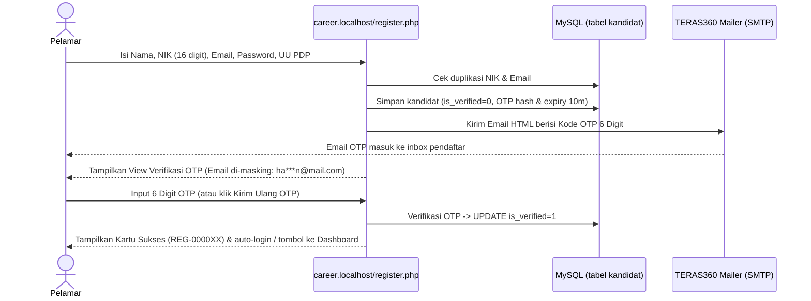

# PRD — Redesign Autentikasi Pelamar (Login, Register + Email OTP & Lupa Password) `career.localhost`

> [!IMPORTANT]
> Dokumen ini telah diperbarui sesuai masukan Anda:
> 1. **Background Slideshow** menggunakan foto momen asli PT. Teras Teknik Perdana (`hero-natural-slide1.jpg` s/d `hero-natural-slide5.jpg` dari `ttpwebase\public\idn\images\`).
> 2. **Verifikasi Email OTP 6-Digit saat Register** (mengikuti pola Email OTP di **Summit** menggunakan Enterprise SMTP `Mailer` TERAS360) sebelum akun pelamar diaktifkan.
>
> Silakan tinjau dan klik **Proceed** untuk memulai implementasi.

---

## 1. Tujuan & Gambaran Umum

Mengubah halaman autentikasi pelamar pada `career.localhost` (`login.php`, `register.php`, `verify.php`) menjadi pengalaman masuk & daftar berstandar enterprise yang menampilkan operasional nyata **PT. Teras Teknik Perdana** sekaligus menjamin validitas identitas pelamar:
1. **Full-Screen Industrial Background Slideshow:** Menggunakan 5 foto momen asli TTP (`hero-natural-slide1.jpg` – `hero-natural-slide5.jpg`) dengan overlay gradasi Navy Korporat TTP (`#062C4E` → `#0B4A7D`) dan kontrol caption/dot di bagian bawah.
2. **Kartu Putih Melayang Berlogo Resmi TTP:** Kartu terpusat (`max-w-[430px]`, `rounded-2xl`) dengan header logo resmi `/assets/images/ttplogo3.png`.
3. **Verifikasi Email OTP 6-Digit (Ala Summit) pada Register:** Mengirimkan kode OTP 6 digit nyata ke alamat email pendaftar melalui `dashboard-k3/includes/Mailer.php` (`mail.teras360.my.id`), lengkap dengan masked email, fitur *Kirim Ulang OTP*, dan masa berlaku kode 10 menit.
4. **Anti-Duplikasi NIK (16 Digit KTP) & Login Fleksibel:** Mencegah akun ganda lewat validasi unik `kandidat.nik_ktp`, sekaligus mengizinkan pelamar login menggunakan **Email atau NIK**.

---

## 2. Spesifikasi Visual & Background Slideshow

### 2.1 Sumber Foto Slideshow (Aset Lokal TTP)
5 foto asli disalin dari `C:\laragon\www\teras360\ttpwebase\public\idn\images\` ke `C:\laragon\www\teras360\hris\assets\images\career-slides\`:
1. `hero-natural-slide1.jpg` — *Access & Tubular Scaffolding Specialist — Proyek Industri & Smelter*
2. `hero-natural-slide2.jpg` — *Refractory Lining & Furnace Maintenance — Standar Keselamatan Tinggi*
3. `hero-natural-slide3.jpg` — *Thermal & Acoustic Insulation — Efisiensi Energi Fasilitas Industri*
4. `hero-natural-slide4.jpg` — *Industrial Blasting & Protective Painting — PT. Teras Teknik Perdana*
5. `hero-natural-slide5.jpg` — *Zero Accident Culture & Certified Workforce — PT. Teras Teknik Perdana*

- Crossfade halus tiap 5 detik + subtle zoom (`scale(1.04) → scale(1)`), overlay Navy TTP, dan 5 tombol dot interaktif di footer.

---

## 3. Alur Autentikasi & Verifikasi Email OTP

### 3.1 Form Login (`career/login.php`)
- **Input:** Alamat Email **atau** 16-digit NIK (`WHERE email = ? OR nik_ktp = ?`), Password (+ tombol *Show/Hide*), checkbox *Ingat saya*.
- **Penanganan Akun Belum Terverifikasi:** Jika pelamar login dengan akun `is_verified = 0`, sistem otomatis menawarkan/mengirimkan ulang kode OTP verifikasi email agar tidak buntu.
- **Lupa Password (Terintegrasi dengan Email OTP):**
  - Pelamar memasukkan email terdaftar → sistem mengirim **Kode OTP 6-digit** ke email via `Mailer` → pelamar memasukkan OTP + Password Baru → password diperbarui aman dengan `password_hash()`.
- **Tautan Bawah:** *Daftar sekarang* → `register.php`, dan *← Kembali ke Daftar Lowongan* → `http://career.localhost/`.

### 3.2 Form Register + Step Verifikasi Email OTP (`career/register.php`)
- **Step 1 — Input Data Pendaftaran:**
  - **Nama Lengkap** (wajib, sesuai KTP)
  - **NIK (16 Digit KTP)** — input angka, counter live `0/16` (hijau di `16/16`), validasi unik di `kandidat.nik_ktp`
  - **Alamat Email** — validasi format & unik di `kandidat.email`
  - **Password** — minimal 8 karakter + *Show/Hide* + **Password Strength Bar** (*Lemah / Sedang / Kuat*)
  - **Konfirmasi Password** — *Show/Hide* + indikator kecocokan live (`✓ Cocok` / `Tidak cocok`)
  - **Persetujuan UU PDP** — checkbox wajib
- **Step 2 — Verifikasi Email OTP (Seperti Summit):**
  - Menampilkan alamat email yang di-masking (contoh: `wi***i@gmail.com`).
  - Input 6-digit OTP besar & jelas (`inputmode="numeric"`, `maxlength="6"`, `tracking-widest`).
  - Tombol **Verifikasi & Aktifkan Akun**, tombol **Kirim Ulang Kode OTP** (dengan cooldown/anti-spam), dan tombol **Batal / Kembali**.
  - Jika SMTP gagal di lingkungan lokal tertentu, pesan error dari `$mailer->getLastError()` dicatat rapi dan ditampilkan informatif.
- **Step 3 — Sukses Terverifikasi:**
  - Menampilkan kartu sukses dengan **Nomor Registrasi (`REG-0000XX`)**, Nama, NIK, Email, serta tombol langsung menuju **Dashboard Pelamar** atau **Pilih & Lamar Lowongan**.

---

## 4. Cakupan File yang Akan Dimodifikasi

| # | File / Aset | Perubahan |
| :--- | :--- | :--- |
| 1 | `hris/assets/images/career-slides/hero-natural-slide1..5.jpg` | Salin 5 foto momen asli dari `ttpwebase\public\idn\images\` |
| 2 | `hris/career/_career_mailer.php` | Helper tipis pembungkus `dashboard-k3/includes/Mailer.php` untuk mengirim template email HTML OTP 6-digit berlogo/warna PT. Teras Teknik Perdana + fungsi `career_mask_email()` |
| 3 | `hris/career/register.php` | Redesign full-screen slideshow + 3-step Register → Email OTP Verification (ala Summit) → Success (`REG-0000XX`) |
| 4 | `hris/career/login.php` | Redesign full-screen slideshow + Login (Email/NIK + Show/Hide + Remember Me) + Lupa Password via Email OTP |
| 5 | `hris/career/verify.php` | Penyelarasan tampilan full-screen slideshow Navy TTP (tetap kompatibel untuk link verifikasi lama) |

---

## 5. Kriteria Penerimaan (Acceptance Criteria)

- [ ] Background slideshow pada `login.php`, `register.php`, dan `verify.php` menggunakan 5 foto asli `hero-natural-slide1..5.jpg` dengan transisi halus, caption bawah, dan 5 dot interaktif.
- [ ] Registrasi memvalidasi NIK 16 digit (anti-duplikasi), email unik, password strength & match, serta UU PDP consent.
- [ ] Setelah submit Register, sistem benar-benar mengirim **Kode OTP 6 digit** ke email pendaftar via Enterprise `Mailer` TERAS360 dan menampilkan tampilan input OTP ala Summit (dengan masked email & tombol *Kirim Ulang OTP*).
- [ ] Memasukkan OTP yang benar mengaktifkan akun (`is_verified = 1`) dan menampilkan kartu registrasi berhasil (`REG-0000XX`).
- [ ] Login mendukung **Email atau NIK 16 digit** serta alur **Lupa Password via Email OTP**.
- [ ] Seluruh file lolos `php -l` tanpa syntax error.
